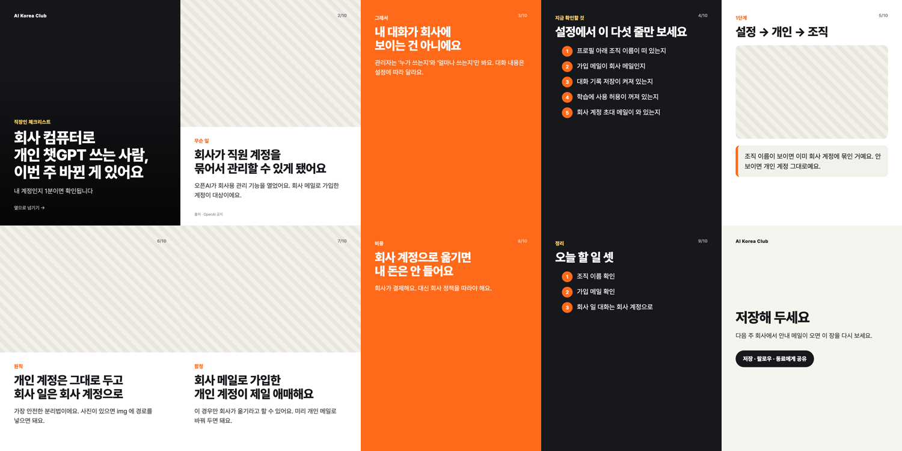

# 실행 예시 (2026-11-09)

`references/slides.example.json`(챗GPT 회사 계정 전환 — 직장인 체크리스트 10장)을 그대로 넣고 돌렸다.

```
$ node scripts/carousel_html.mjs slides.json out
HTML: out/carousel.html (10장)
PNG: out/01.png
PNG: out/02.png
PNG: out/03.png
PNG: out/04.png
PNG: out/05.png
PNG: out/06.png
PNG: out/07.png
PNG: out/08.png
PNG: out/09.png
PNG: out/10.png
```

10장 모아보기(`examples/모아보기.png`, 각 장 1080×1350을 줄인 것):



장 순서와 판: 1 표지(cover) → 2 위 사진(photo) → 3 주황 바탕(accent) → 4 차콜 목록(dark-list) → 5 단계(steps) → 6 위 사진 → 7 위 사진 → 8 주황 바탕 → 9 차콜 목록 → 10 저장(save). 연달아 같은 판이 없고, 사진이 없는 장은 빗금 자리표시가 들어가 어디에 사진을 넣을지 보인다.

메모: playwright-core 가 없는 환경에서는 PNG 줄 대신 "PNG 건너뜀" 안내가 나오고 carousel.html 만 생긴다. 그 파일을 브라우저로 열면 장이 세로로 이어져 있어 장마다 캡처하면 된다.
